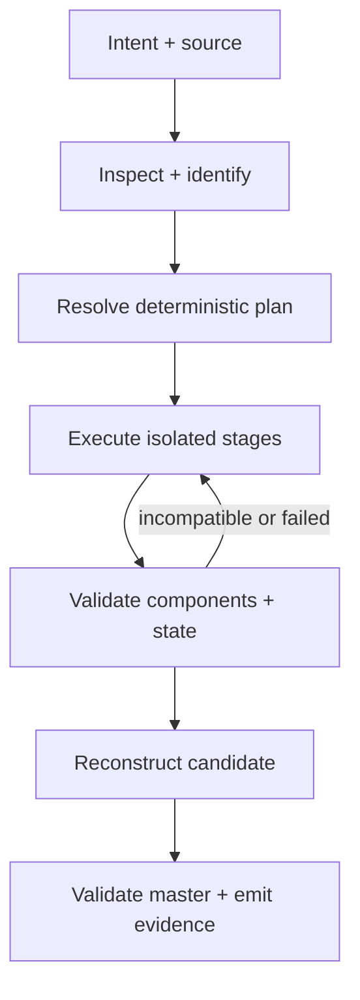

# aniflow Architecture

## Purpose and scope

This document defines how aniflow is structurally organized so its temporal
domain remains independent of delivery, external commands, filesystems, and
suite orchestration. It governs dependency direction and communication patterns,
not detailed APIs or the current module tree.

Current source reconciliation is pinned to main
`2add9a6b230aaf415288e6c128bcf276dc05681c` on 2026-10-27, with generic
selective repair and per-frame Upscayl recovery merged. This #38 checkpoint
builds on named allenk draft #128 and adds selected media setup mapping; chunk
draft PR #127 remains separate. The boundaries
below describe authored implementation, not current-source execution or release
qualification. [The current roadmap](../../../ROADMAP.md#current-source-and-work-order)
separates landed checkpoints from remaining work and historical evidence.

## Structural units

| Unit | Responsibilities |
| --- | --- |
| Domain | timeline, streams, artifacts, processors, stages, plans, checkpoints, validation semantics, and domain errors |
| Application | inspect, validate configuration, plan, start, resume, cancel, query status, reconstruct, and coordinate use cases |
| Ports | media probe/decode/encode, processor execution, filesystem, hashing, clock, signals, event sinks, and resource observations |
| Adapters | FFmpeg/FFprobe, external processors, local filesystem/process runtime, serialization, and future platform integrations |
| Delivery | public Rust facade, CLI argument mapping, human presentation, and versioned machine envelopes |

## Offline setup planning

The `toolchain` library module compares an explicitly selected capability
profile against local file identities and attributed caller inventory. Its
versioned report separates filesystem observations, supplied build/version/model
and hardware evidence, and unmet setup requirements. The CLI renders the same
report through human or machine delivery.

Offline inspection has no dependency execution or installation port. The
separately invoked probe operation uses a bounded process adapter for fixed
FFmpeg/ffprobe diagnostic queries, retaining process and parse evidence. It
uses non-reaping process observation on Linux and macOS; other live host
adapters remain explicit follow-up work. It
collects compiled capabilities without claiming available hardware or native
qualification. It neither constructs runtime providers from native CLIs nor
changes `ProviderRegistry`
selection, registration confinement or provider-lock v1. Adapter-specific closed
configuration remains responsible for binding package revision, backend and
settings before processing. Inventory consistency is separate from native
qualification. The opt-in #103 audio preflight binds selected profile/inventory
evidence to the closed native-v2 inspection configuration and exact lock tools.
An optional digest in the immutable plan requires the same preflight document
and fresh file checks before run/resume source rebinding, cache access or launch.
Unmapped stages retain existing exact-lock checks. Selected frame setup derives
existing typed configurations without extending this audio preflight wire
contract. Further typed mappings and environment/device qualification remain
#38 work; no implicit setup is added.
See the [toolchain guide](../../toolchain-profiles.md) and ADR-0003's independent
executable boundary.

The guard's compatibility and persistence rationale is proposed in
[ADR-0010](../governance/decisions/ADR-0010-plan-bound-toolchain-preflight.md).

The landed #104 preparation operation constructs matching registration,
manifest, effective-configuration and preflight documents for the native-v2
audio-inspection adapter. It reads bounded local identities and returns inert
JSON; the caller still reviews and places the documents explicitly. Preparation
neither launches tools nor registers providers, writes setup or decodes media.
Compare the first plan's adapter digest with the preparation observation;
registration v1 does not itself pin that preparation-time digest. This is one
typed mapping, not a general installer or complete environment qualification.

The selected media preparation operation maps one explicit profile capability
and inventory to the existing allenk image-repair or Upscayl recovery
configuration. Its closed selection maps dependency IDs; the capability's
`effective_settings` is the sole typed options source. Shared offline inspection
owns bounded file hashing, while the mapper requires the exact dependency kinds,
settings, selected flags/features, package/version evidence, effects and
backend/scale declarations. A ready result contains one inert configuration
with canonical identity. Unready dependencies retain diagnostics and no files.

This setup operation reads no source media and has no process, network, install,
configuration-write or provider-registration port. Media facades continue to
construct source-bound stages and exact locks and freshly check their component
identities for planning/run/resume. Setup readiness is an attributed local
observation, not processing permission or checkpoint acceptance authority.
Native qualification remains false; complete runtime/host identity remains
unobserved. See the [selected setup guide](../../toolchain-media-setup.md).

## Temporal and indexed-frame boundary

`temporal` owns exact rational time, input-global stream identities, decoded
frame intervals, packet timestamps and typed support decisions. Inspection can
retain a well-formed unsupported source. The current processing policy admits
contiguous zero-origin CFR with a unique or explicitly selected moving-video
stream and optional audio; every other stream requires explicit discard
acknowledgement. VFR, unsupported offsets and contradictory clocks are refused
rather than normalized. Legacy floating-point summaries never select the
reconstruction grid. Pipeline v2 processing and segmentation now use this exact
record, while old run state without it requires a new run. Generic Pipeline v3
providers retain their capability-specific temporal contracts.

The optional `video_interpolation` adapter reuses that clock for indexed
RGB8/SDR frames and same-duration 2x RIFE output. It invokes serial frame pairs
under the existing provider/runtime authority and leaves final-video assembly
and selected audio handling to later #110 work. Memory admission is an
uncalibrated estimate, not an enforced RAM/VRAM quota. Its PNG structure/CRC
checks do not prove decompression or native visual quality.

The pure `frame_selection` planner reuses the complete declared frame index to
project inclusive user selections into half-open ordinal ranges and exact
source-time spans. It does not observe source/image bytes, import a stage or
establish historical processing. The merged `frame_import` facade binds actual
source/index/frame bytes and full bounded PNG decode observations to a new
ordinary Pipeline v3 stage. Historical processing stays unknown; the supplied
relationship between source video, timing and PNGs remains a bound declaration.

The `frame_repair` checkpoint composes that importer and a selective direct-image
processor as two ordered stages in the same run. Dependency acceptance remains
owned by Pipeline v3; a standalone import report is not accepted-stage authority.
Only explicit inclusive ranges reach the processor. Every unselected frame is
copied unchanged, and the complete output index retains names, ordinals,
geometry, source clocks and cuts. Process success, decoded output observations,
actual byte changes and visual repair quality remain different facts.

The generic direct-image profile binds a caller-selected executable and literal
arguments. It does not qualify named logo-removal providers, implicit models,
clip splitting or detector-driven edits. Native children inherit the existing
outer process group; this creates no nested process runtime or arbitrary DAG.
This initial capability requires a fresh run and explicitly refuses generic
Pipeline v3 resume before durable transitions, because its external model and
environment identities are unobserved. Read-only status remains available;
existing cache and resume policies for other capabilities are unchanged.
A separate typed allenk image profile uses a distinct capability and closed
configuration, sharing the existing import/repair copy-and-decode loop. Fixed
argv selects one visible-overlay profile without denoising or automatic fallback.
It binds the binary, decoder, embedded profile choice and threshold. Native
version is observed before repair execution. Whole-stage resume rechecks actual
component files and exact importer provenance before reuse; an interrupted
repair retries all selected frames. A caller's arbitrary generic profile label
cannot obtain this authority. Embedded assets are identified through the binary;
shared-library/host identity and visual suitability remain unqualified. Reusing
an accepted whole stage does not promise cross-host deterministic processing.

The fixed wrapper validates its output observations before the ordinary runtime
can accept the complete stage. Existing ADR-0003/0005 govern tool and temporal
boundaries; ADR-0008 retains its proposed status. No new acceptance owner is
introduced. See [exact timing](../../temporal-correctness.md),
[RIFE](../../video-interpolation.md), [frame import](../../frame-import.md) and
[selective repair](../../frame-repair.md).

The #37 Upscayl recovery facade expands a bounded frame set into ordinary ordered
Pipeline v3 stages, one frame per stage, followed by a complete-set collector.
Each frame has its own accepted output and decode observations. Independent
frame stages do not depend on earlier frame outputs; the collector depends on
every frame. Existing checkpoint compatibility, writer ownership, invalidation,
failure retention and immutable publication remain authoritative. Loose PNGs or
reports cannot establish a reusable accepted frame. Exact binary/model pins and
settings are required; native model scale and requested output scale are distinct.
Changed source or settings require an explicitly compatible plan or a new run.
The collected spatial output index retains the original source index and timing
verbatim, and records scaled geometry separately. It does not rewrite a source
inspection or claim automatic compatibility with RIFE input profiles.

After built-in integrity validation, stage acceptance rechecks its declared
inputs and accepted outputs. This avoids repeatedly hashing every unrelated
frame and the complete source video for each frame checkpoint. External
validators still trigger the complete artifact scan. Before-use checks,
checkpoint compatibility and the final whole-run integrity gate remain in
place. Mutation of an unrelated artifact can be detected at its next use or
final delivery rather than immediately after an independent stage; it cannot
justify completed whole-run delivery.

Per-frame process recycling is a named execution policy, not a second scheduler.
It has a finite frame bound and no hidden retry loop. Native children inherit
the existing provider process group. Caller-prepared tools and observed model
bytes do not qualify a device/driver, certify temporal visual quality or enforce
a GPU memory quota. Native directory batches retain their existing behavior;
bounded chunks are authored in separate draft PR #127, with historical adoption
and native qualification remaining #37 scope. See the
[recovery guide](../../upscayl-recovery.md).

## Dependency direction

Dependencies point inward:

```text
CLI and other delivery adapters
        -> public aniflow facade
        -> application use cases
        -> temporal domain

external adapters -> inward-facing ports
```

The domain does not import CLI, serialization, process, or filesystem behavior.
Application code depends on ports rather than concrete tools. Adapters may use
domain and port types but cannot become alternate owners of temporal rules.

## Runtime flow



The target is a resolved stage graph, but aniflow does not adopt arbitrary DAG
complexity until a real temporal workflow needs branching or fan-in. Ordered
processor chains remain the simplest supported composition primitive.

## Public library and CLI boundary

The Rust library is the behavioral product. The CLI maps arguments into typed
requests, subscribes to events, and renders results. JSON and other machine
formats serialize versioned result contracts; console prose is not an API.

The initial extraction uses one Cargo package with a library target and binary
target. Further crate separation requires an independently useful API, compile
boundary, feature boundary, or release boundary.

## Processor boundary

Processors declare identity, capabilities, configuration, inputs, outputs, and
resource expectations. External commands use direct argument arrays without a
shell. The runtime captures stdout and stderr independently, redacts sensitive
diagnostics, forwards cancellation, observes declared outputs, and separates
process exit from artifact validation.

Typed first-party adapters translate configuration into this contract. A
generic command adapter is an explicit escape hatch, not permission to bypass
validation.

The provider-native contracts cover declarations, effective configuration,
compatibility fingerprints, explicit local registration, deterministic
resolution, standalone locks, lifecycle events, and bounded execution reports.
The local runtime re-verifies executable identity before launch, terminates
process groups on Unix, and accepts completion only after strict artifact
validation. Pipeline v2 frame, batch, audio, and whole-video adapters now use
that runtime and add temporal validation before promoting temporary output.

Pipeline v3 adds one closed provider invocation ABI:
`<executable> --aniflow-invocation <request-path>`. The ephemeral request binds
the exact provider-lock digest, effective configuration, and typed input and
output ports, including whether each artifact is a file or directory. Runtime
paths enable the local invocation but do not enter durable compatibility
identity. The executor supports exactly one artifact on each `one` output
port and an explicitly planned nonempty member set on `one_or_more` or `many`
ports. Every member retains a unique artifact ID and disjoint exact path.
The #69 extension selects invocation/report v2 for stages declaring multi-artifact
ports; all-`one` stages keep v1. Report schema and invocation semantics remain
bound into reuse identity, and no member may be discovered after planning.
Every artifact receives mandatory built-in
`aniflow.validation/artifact-integrity/v1`. #33 adds explicit inline
provider-artifact and temporal-media gates, with exact locks resolved during
planning and aniflow-owned acceptance. Unsupported cardinality/profiles,
lifecycle-observer stages and publish authority are rejected before mutation
or launch. See [layered validation](../../layered-validation.md) and
[proposed ADR-0008](../governance/decisions/ADR-0008-layered-validation-acceptance.md).
The #33 and #69 implementations are authored with test/check execution deferred
under #64. ADR-0008 records the bounded extension without claiming acceptance.

## Native audio evidence boundary

Issue #80 extends the existing inspection adapter with classic RIFF32 PCM24
and finite IEEE float32 alongside PCM16. Technical report v2 and provider v2
bind native sample encoding, exact source/sample digests and same-encoding decode
verification. Historical technical v1 remains readable. A new signal v3 companion
and explicit native settings use source-format full-scale ratios; they never
reinterpret PCM16 thresholds or clamp floating-point headroom. Native loudness
and true-peak methods are explicitly unavailable in this bounded implementation.
The legacy PCM16 signal algorithms and historical companions retain their meanings.

Model-backed musical, transcription, alignment and MIDI consumers remain PCM16
profiles and reject broader samples before inference. All profiles use the same
Pipeline v3 source, provider, checkpoint and resume owners. Native format
acceptance does not imply platform qualification, a model's compatibility,
creative approval or media finishing. See [the native audio handoff](../../validation/aniflow-80-checkpoint.md)
and the companion note in [proposed ADR-0006](../governance/decisions/ADR-0006-audio-analysis-foundation.md).

## State and checkpoint architecture

The first typed audio-separation provider uses that existing ABI with vocals,
accompaniment, and evidence output ports. Its bounded PCM WAV profile validates
sample integrity and duration before returning candidate outputs. The host's
built-in integrity validation remains a separate completion gate. A thin local
preparation/task adapter records and rechecks external model/tool identities
before invoking the public run/resume path; the model cache stays outside run
artifacts. This is a specialization of the existing external-tool boundary,
not an alternate execution or checkpoint owner. See
[offline Demucs](../../offline-demucs.md) for its precise support limits.

The bounded [stem-lineage importer](../../audio-stem-lineage.md) selects an
accepted prior separation output through declared artifact roles and verified
Pipeline v3 records. The public analysis facade retains the mix/stem relationship
without interpreting provider-native JSON. Ordinary inspection/signal stages
measure the selected full stem, followed by a lineage stage that emits the final
normalized analysis. This is explicit input import into a new run, not another
checkpoint owner, a general completion gate or automatic cross-run reuse.
[Proposed ADR-0007](../governance/decisions/ADR-0007-provider-neutral-stem-import.md)
records the boundary and its direct-mix, full-selection and duration limits.

A Pipeline v3 run has an isolated workspace, an immutable plan snapshot,
append-only self-validating run-manifest revisions, and immutable stage
checkpoints. Stage outputs are immutable. State transitions preserve pending,
running, validating, complete, failed, cancelled, invalidated, and skipped
distinctions. A checkpoint is published only after its provider report, output
observations, and required validations are durable.

A checkpoint binds the relevant stage-plan fragment, exact provider lock,
invocation and execution semantics, ordered input and dependency identities,
provider execution-report identity, output kind/count/size/content, and typed
validation observations. Reuse is a compatibility decision with an
explanation, not a marker-file lookup. Resume re-resolves explicitly supplied
provider registrations and requires the complete lock to equal the plan before
it can reuse or execute a stage. Changed source or provider authority fails
closed; changed accepted output invalidates the affected stage and its
downstream consumers.

Run-state updates never replace prior revisions, and checkpoints never replace
prior evidence. `status_v3` and other read-only operations never create or
repair workspace directories implicitly. Pipeline v2 retains its existing
workspace and completion-marker behavior as a compatibility boundary.

## Communication patterns

- Typed requests and results cross application boundaries.
- Structured events report lifecycle and progress without defining state.
- Raw logs remain separate from interpreted events.
- Versioned manifests persist plans, observations, transitions, and artifacts.
- Atomic writes and explicit validation guard state changes.
- Bounded worker pools and cancellation tokens control expensive work.

## Cross-repository boundary

aniflow exposes a stable library and CLI but imports no flow, optiflow, or
renderflow code. flow may adapt aniflow's public contracts and coordinate its
master with sibling capabilities. Pipeline v2's optional renderflow field is a
deprecated compatibility seam; pipeline v3 removes cross-holon selection.

## Security and privacy constraints

Sources remain read-only, generated paths stay within explicit workspaces, and
path traversal is rejected. Configured executables run with the user's authority
and therefore remain trusted-code decisions. Secrets and unnecessary absolute
paths are excluded from persisted machine output. Remote processing, destructive
mutation, and signing require separate explicit capabilities and policy.

## Current implementation gaps

| Boundary | Authored source and remaining gap |
| --- | --- |
| Versioned command results | Machine envelope and typed failures exist; independently versioned per-command result schemas await real `flow` evidence |
| Provider contract | Explicit registration, exact locks and bounded execution cover Pipeline v2 processor families and the ordered Pipeline v3 subset; exact nonempty output sets use invocation/report v2, while all-`one` stages keep v1. Dynamic or empty outputs remain refused |
| Process runtime | Pipeline v2 processors use bounded provider execution; FFmpeg/FFprobe and the deprecated renderflow handoff remain legacy adapters outside this checkpoint |
| Deterministic plan | Pipeline v3 has a canonical self-validating plan; Pipeline v2 retains its compatibility planner |
| Compatible checkpoint | Pipeline v3 has immutable content-aware checkpoints and append-only run manifests; Pipeline v2 retains legacy completion markers |
| Temporal domain | Exact observed CFR grids, explicit stream choices/discards and typed refusals are authored; VFR/nonzero-origin processing, RIFE final-video assembly and native qualification remain open |
| Toolchain setup | Core Linux/macOS diagnostics, selected audio preflight, native-v2 registration preparation and selected allenk/Upscayl configuration preparation are authored; other mappings, model discovery, complete environment/device evidence and qualification remain #38 work |
| Frame adoption and repair | Generic repair preserves complete mappings and unselected bytes; the typed allenk capability adds whole-stage resume with exact same-run import provenance. External migration, GWR integration, clip limits/seams, optional detection and native qualification remain #36 work |
| Upscayl recovery | Per-frame execution reuses v3 stage checkpoints and a complete-set collector; separate draft PR #127 authors chunks. Historical import and native/failure qualification remain #37 work |
| Cross-holon independence | Optional renderflow invocation remains in pipeline v2 |
| Layer separation | Large orchestration module combines multiple system responsibilities; keep further splits tied to a concrete consumer boundary |
| Qualification and release | Source package version remains 0.3.0/unreleased; #64 owns deferred execution and the known alignment cancellation failure, #10 owns the first qualified immutable release |

## Assumptions and open questions

The rational timeline and stream-selection model is implemented; broader
processing profiles and future type decomposition still require evidence.
Pipeline v3 execution is intentionally an ordered bounded subset with
explicit nonempty output-member sets, mandatory per-member integrity and
explicit inline validation profiles. Optional/unbound ports, zero-output stages
and dynamic fan-out remain refused. Arbitrary DAGs await separate evidence;
#34's optional cross-run reuse requires exact origin proof and current
acceptance. `validation` owns public observation and
acceptance contracts, while `run_v3::validation_gate` connects them to exact
runtime locks, checkpoints, status and final delivery.
Provider lifecycle events are versioned at execution granularity; native
item-count and fractional progress await real provider protocol evidence.

## Validation

Architecture review, library examples, CLI contract tests and temporal,
interruption and resume fixtures are the intended verification surfaces. This
reconciliation used source review only. Tests/build/lint/format/schema/native
and hosted checks remain deferred under #64; old receipts do not qualify this
source. Proposed ADRs keep their recorded status after implementation or merge.

## Owned local stage reuse (#34)

`cache_v3` owns explicit namespace policy, sealed storage, locks, bounded inventory
and retention operations. `run_v3::cache_gate` bridges exact stage identities and
origin evidence into the existing current-plan acceptance path. Producers may be
reused; required current validators still execute. The CLI delegates to public
library operations, and Flow receives versioned decisions/diagnostics. Source and
run data stay outside the cache ownership boundary. Read-only APIs never perform
cleanup. Pending reruns and excluded checkpoints live in the run manifest.

See [the proposed cache ADR](../governance/decisions/ADR-0009-owned-stage-cache.md)
and [implementation specification](../../specs/content-addressed-reuse.md).
Qualification remains deferred under #64; architecture implementation is not
native-platform or release evidence.
