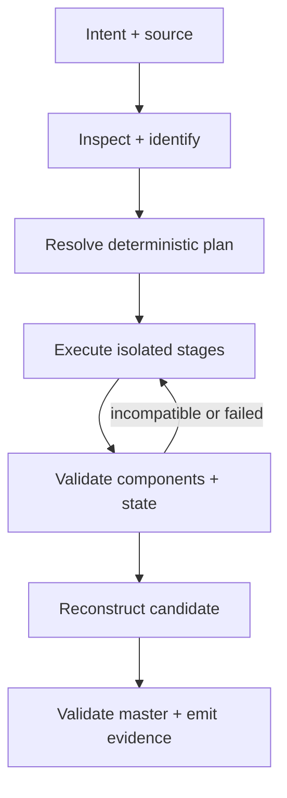

# aniflow Architecture

## Restore retained detached candidates (#82)

The existing detached byte-retention owner can copy one caller-pinned retained
subject/proof candidate and its fixed private metadata to a fresh root. Bounded
planning, source reobservation, no-clobber copies and completion-last receipt
delivery preserve the exact original inspect contract, even when original
production/bundle paths are unavailable. It does not parse or cryptographically
bind an OTS proof, contact a calendar/verifier, upgrade it or establish trusted
time/ownership. Those outcomes remain explicitly unverified and separately
gated. No second provenance ledger or restore acceptance authority is added.

## Recovered recipe release entry (#107)

A separately versioned read-only entry projects the existing recovered v1 or
optional-RIFE v2 owner and current initialized native child states. It requires
an exact existing intent and exposes recovery/inspection advice without
resuming, importing, approving or promoting incomplete native work. An optional
release tail binds only the exact currently accepted master from that same
recovered root and output. Context/state is reobserved through existing owners;
no new checkpoint, acceptance or scheduling authority is introduced. Proposed
ADR-0023 includes this extension; source/indexed entry contracts stay unchanged.

## Local selected toolchain package (#38)

The existing inert workflow setup owner can write only its explicitly selected
ready configurations to a new private local package, with the exact supplied
request and an externally pin-able completion manifest written last. Readback
checks bounded exact membership, document digests and role/capability/config
bindings; optional current dependency comparison reruns preparation without
installing, discovering, registering or executing providers. The package does
not copy tools/models, move private locators to public output, grant execution,
or change native readiness/qualification authority.

## Explicit historical import preparation (#37)

Read-only preparation turns an explicitly ordered original-ordinal/file
selection into the existing hash-bound historical import request and current
review subject. It neither searches a folder nor infers prior processing or
approval. Optional request-file delivery is private, no-clobber and disjoint
from selected inputs/tools. Existing historical review, native full decoding,
checkpoint acceptance and spatial carrier owners remain unchanged.

## Recorded recovery throughput (#37)

The recovery inventory keeps its existing recorded-state and reuse boundary.
A separate progress projection binds completed frame/chunk checkpoints to their
exact retained successful provider-execution reports and sums measured serial
work durations. It reports a conditional remaining-work estimate with explicit
sample coverage and exclusions, never a completion deadline or current native
acceptance. Missing, changed or unrelated timing evidence is not inferred.
Read-only CLI delivery uses this same library owner; no runtime, journal or
output-reuse authority is added. Native timing usefulness remains unqualified.

## Source-entry journey before assembly (#107)

A separate source/indexed entry view projects the existing immutable recipe and
current native phase/checkpoint identities before a final master exists. The
existing accepted prepared-frame owner supplies any actual review subject;
missing carrier or parent acceptance never becomes guessed timing/completion.
Explicit supplied decisions delegate to that same writer/gate, without running
assembly. Only actual accepted final-video bytes can bind the optional unchanged
release-stage v1 tail. Source, configuration, native status and exact decisions
are reobserved; the view adds no run state, scheduler or media acceptance owner.
Proposed ADR-0023 includes this extension; native/workflow qualification remains
deferred and the prior accepted-master entry keeps its serialized meaning.

## Fixed selectable release-stage journey (#107)

A closed ordered intent projects an already accepted master through existing
manual lyrics, finishing, publishing and exact-byte retention owners. Four
authored modes are explicit; only concrete supported owner/mode combinations
can report current evidence. Missing providers/modes/hooks are unavailable;
unfinished stages block later enabled rows. Disabled optional rows retain a
reason and create no output. Exact predecessor media/configuration/clock and
review bindings are reobserved without launching tools. This is a read-only
domain composition and bounded handoff surface, not an executor, arbitrary DAG
or another acceptance database. Broader raw-source/manual-video composition and
qualification remain open; proposed ADR-0023 records the boundary.

## Explicit local record-evidence notes (#116)

One selected loopback model adapter reuses the registered provider runner for
exact interpreter/configuration locks, direct argv, process-group cancellation,
deadline and output bounds. A bundled pinned adapter reads only normalized AMV
facts, checks service-reported model/version/digest around one structured call,
then returns a separate candidate. Current final-video identity and host citation
validation remain authoritative. Deployment is private; portable telemetry is
an explicit content-free projection. Loopback requires the SDK network grant;
neither an offline sandbox nor actual model weights are attested. Disabled and
unavailable selections never fall back. Media samples, human approval and
technical acceptance remain separate. Proposed ADR-0022 records the extension;
backend/native/hardware qualification stays deferred.

## Optional evidence-only AMV advisory (#116)

An inert preparation projects an explicitly selected current final-video
handoff into bounded normalized facts and exact record/digest citations.
Supplied advisory data is a separate sidecar: host-rendered observed facts,
unverified suggestions/questions, and explicit coverage/omissions. Current
source and acceptance identity must still match at validation. No media samples,
provider invocation, Flow dependency, recipe mutation or human approval follows.
Existing native temporal acceptance and exact-candidate human review remain
their respective owners. See proposed ADR-0022; runtime/profile adoption and
actual model/visual usefulness remain separate qualification work.

## Bounded recovered RIFE chunks (#110)

A separate explicit chunk request resolves a fixed finite native v3 graph over
the complete recovered carrier. Each output range is an ordinary checkpoint;
a complete-set collector requires every exact matching native producer before
publishing the existing full recovered RIFE output index. Original source clock,
cut/endpoint mapping, recovered lineage and complete audio extent remain in the
existing owners. The same serial pair renderer handles whole and ranged work.
Plans are rederived from current source/tool/model/provider/settings on resume;
loose chunk files and collector-only graphs cannot become accepted recovery.
Assembly recognizes this explicit native graph through current complete native
acceptance, retaining the existing full carrier/derived-clock semantics. This
adds no acceptance database, general graph engine or native/model qualification.

## Video publishing with recognized QC (#107)

An explicit publishing v2 request/intent/plan/status selects recognized final-
video audio QC. A partial recognized child can resume; an actual completed child
can finish an interrupted parent binding before preflight. Unknown or legacy
partial QC is retained/refused. Source/export writer ownership is handed to the
QC owner during that phase, then current source/QC/native evidence is held while
the parent binding is committed. V1 fresh-only meanings remain unchanged. Final
whole-file/public-metadata review, separate post-approval resume, local package
and optional unsealed retention remain existing independent owners.

## Explicit short deflicker comparison (#106)

A fixed optional comparison owner selects an exact accepted H.264 SDR source
and at most 240 original-CFR frames. An explicit closed FFmpeg deflicker choice
creates before/after RGB PNG sequences, source-time mapping and a local silent
comparison viewer under ordinary native v3 acceptance. No selection is a saved
bypass and reads no tool/model. Temporal filtering is preview-only; original
media/audio and final export ownership remain unchanged. Full decode/hash and
PNG checks establish bounded technical observations, never perceptual quality.
A separately supplied immutable review binds the actual comparison/context and
cannot promote it into a complete final export or publication. Native/visual
qualification remains deferred; this is not an implicit production polish step.

## Recognized final-video audio QC resume (#83)

A distinct explicit resumable wrapper binds current accepted final video and
its exact selected AAC extent to private capture/decode boundaries, one fixed
ordinary native signal child and a retained meter observation. The existing
source-signal decoder/extent/receipt checks remain shared owners. Status reads
current identities, frozen actual decoded plans and native checkpoints without
launching probes, decode or inference. Half-written or unknown initialization
is retained/refused; complete native work can resume only under exact settings.
The final existing-shaped QC receipt is published last and still requires an
external digest for readback. V1 fresh-only APIs and legacy partial roots keep
their meanings. No new media acceptance database, musical approval or release
is inferred; proposed ADR-0019 records the composition extension.

## Whole selected workflow readiness (#38)

A bounded inert workflow preparation composes the existing per-domain media
setup mappings. Each selected role retains its exact owner/configuration and
dependency diagnostics; omitted roles load no files/models and are listed as
omitted, never ready. All selected preparations are reobserved before returning
one whole-selection readiness result. This is not an execution plan, provider
registration, install, source-media inspection or native/hardware qualification.
The separate core/publishing requests retain their serialized meanings.


## Recognized resumable final audio QC (#107/#83)

A separate resumable-QC request wraps explicit final-QC v2. Immutable capture
and decoded-subject markers identify finite restart boundaries. Half-written
capture/decode documents or unknown roots are retained and refused. Native
signal analysis runs in one fixed child and keeps ordinary v3 plans, checkpoints,
acceptance and compatible resume; markers add no media acceptance. Meter evidence
binds that actual accepted child and exact decoded samples before qc.json is
written last. Status rederives exact plans from current identities without
process launch. Execution retains native dependency preflight. A separate audio
publishing v2 selects this owner and can finish its missing parent binding only
from its exact recognized child. V1 publishing/QC partial roots are not adopted.
Manual review, separate post-approval resume, packaging and unsealed retention
retain existing boundaries. No algorithm/platform/creative qualification follows.

## Explicit original-rate 44.1 kHz final QC (#83)

Final lossless QC has an explicitly selected v2 request/intent/report. It adds
an unqualified 44.1 kHz native PCM16/PCM24/float32 meter view over the existing
two-pass ebur128 parser/argv, source-rate window thresholds and independent
native sample peak. A v3 meter receipt distinguishes this rate from existing
48 kHz v1/v2 views. Final bytes, complete decoded samples, rate, channels and
precision remain unchanged. V1 QC keeps its original 48 kHz support and typed
unavailable 44.1 kHz observations; saved v1 receipts are not upgraded by new
code. Unsupported/silent/short/below-gate quantities remain typed. Runtime,
algorithm, platform and musical qualification remain separate and unestablished.

## Optional RIFE in recovered recipe v2 (#107/#110)

A separate v2 request/intent/plan/status composes the existing recovered sparse
work and complete-carrier owners, optional recovered-input RIFE, an accepted
RIFE assembly carrier and native assembly. V1 recovered wire meanings remain
unchanged. Only an explicitly enabled interpolation configuration admits RIFE
tools/models/resources; omitted interpolation loads none of them. Original
clock/audio extent, historical origins and actual native acceptance remain in
their existing owners. Plans for future-output children are resolved only from
accepted predecessors. Fixed slots and immutable intent locate native authority;
the parent owns no independent media acceptance. Resume reuses current compatible
native children, preserves/refuses partial carrier publication and leaves RIFE
writer ownership with assembly. Final completion projects the actual accepted
assembly for existing finishing/publishing consumers; it grants no review.

## RIFE over complete recovered frames (#110)

A distinct recovered-input binding lets the existing serial RIFE renderer
consume a currently valid complete spatial carrier. That carrier retains the
original source inspection and unknown/observed per-frame history; it is never
coerced into a native Upscayl index. A separate closed native wrapper binds its
exact current carrier bytes, actual processed PNGs and original full-duration
2x clock. Ordinary v3 owns execution, accepted output and compatible resume.
The shared renderer, pinned private tools/models, process/capture/resource
boundaries and output checks remain unchanged owners. A v2 RIFE assembly
carrier records recovered lineage without changing v1 original/native-spatial
semantics; assembly uses a distinct v3 operation for this new index kind. Native
and human visual qualification stay unestablished. No model execution occurs
during plan/readback; proposed ADR-0020 records this extension.

## Core extraction and assembly preparation (#38)

The existing inert typed media-setup owner also maps original-clock frame
extraction and clean FFV1 master/H.264 delivery assembly to exact supplied tool
roles, build-feature declarations and closed domain settings. A separate bounded
core preparation composes only explicitly selected extraction/assembly mappings;
publishing preparation retains its own selected scope. Both use the same current
dependency inspection without media reads, process launch, model requirements,
configuration writes, registration or installation. Assembly readiness includes
the existing full-frame hash/decode and clean-master/delivery prerequisites;
source-specific geometry, native acceptance and runtime qualification remain
pending in the actual domain owner. No processing or proof of readiness is
inferred for an omitted step, and no new runtime/provider authority is added.

## Fixed audio-only publishing continuation (#107)

The publishing owner has a separate immutable audio entry for one current
accepted PCM or lossless native subject and a dated supplied manual SoundCloud
or DistroKid profile. Its fixed sequence is optional source-preserving native
WAV/FLAC export, optional exact-final-file native QC, destination preflight,
supplied whole-file/public-metadata review, copy-only manual package, and an
optional unsealed retention handoff. Existing native v3 plans/checkpoints and
the exact final-QC owner supply authority. Compatible export resume cannot adopt
loose output, partial QC, incomplete package or a different original source.
The video and audio entries share final review/package/retention inspection,
with distinct request/intent/plan/status contracts and fixed child slots.
Recording one supplied approval or rejection executes no packaging; approval
requires a separate resume, rejection is retained, and decisions cannot be
overwritten. Status/advice executes nothing. No uploader, new DAG, second media
acceptance database, sealing, signing or release action is added. Source merge
does not ratify ADR-0019 or qualify native behavior; flow #88 remains last.

## Exact final lossless-audio QC (#83)

The delivery-audio owner may observe an explicitly selected current accepted
PCM file or native lossless export in a fresh private QC root. The exact final
file and producer acceptance are frozen separately from original PCM identity.
For FLAC the existing lossless native adapter decodes the complete native
integer samples and wraps them in a minimal WAV without rate/channel/precision
conversion. WAV is copied exactly. The existing native signal pipeline owns
the new sample measurements and acceptance; no parent acceptance database is
introduced. A separately versioned existing ebur128 meter view admits 48 kHz
native PCM16/PCM24/float32 mono/stereo without quantization. Other rates retain
typed unavailable quantities instead of implicit resampling or invented zero.
Native algorithm/platform qualification and creative review remain separate.
Receipt readback requires an external digest and rechecks exact source, private
snapshots, native child, components and complete decoded samples. A changed
final tag or container byte invalidates QC even with unchanged PCM. Preflight
uses this explicit final QC when selected and cannot borrow original meters.
See proposed ADR-0019; all execution/qualification remains deferred to flow #88.

## Selected publishing dependency preparation (#38)

The existing inert media-setup owner maps final-video and final-lossless audio QC, metadata-only
remux and source-preserving lossless export to explicit local tool roles and
closed domain settings. QC requires the complete native float decode and both
existing ebur128 passes, including their metadata, padding and null-output
features. Accepted soft-subtitle preservation additionally requires the actual
subtitle decoder, extraction encoder/muxer and disposition flag. It never
requires a subtitle encoder for a stream-copy operation. A bounded publishing
preparation composes only explicitly selected mappings over one profile and
inventory. Each selected prerequisite must be ready; omitted steps and native
runtime, provider, source/review/platform qualification remain unobserved.
Preparation reads dependency/font identities and supplied observations without
source media, process launch, configuration writes, installation or downloads.
This extends the existing owner and adds no runtime or new provider authority.

## Recovered-frame music-video continuation (#35)

The fixed recovered entry freezes the original source/index, accepted selected
origins, missing ordinals and bounded native child plans. Only missing original
PNGs enter fresh sparse per-frame work; ordinary v3 resume reuses compatible
accepted frame checkpoints. The v2 sparse operation admits original ordinals
below 100000 with at most 128 selected frames per run, without renumbering or
changing v1 meanings. After those children complete, the entry creates the
complete copy-only carrier and hands it to the existing native assembly owner.
Assembly has a distinct v2 operation/schema for this carrier and keeps the
original temporal inspection intact. The existing full decode/pixel/clock/AAC
and delivery gates remain authoritative. Parent status/completion rechecks
original intent, actual children and carrier; it records no independent media
acceptance. There is no general graph, automatic import approval, historical
native attribution or second checkpoint database. Source/indexed entries remain
unchanged, and creative/publication review remains separate. ADR-0018 remains
proposed; all execution/qualification remains deferred to flow #88, last.

## Complete recovered spatial frame carrier (#37)

`upscayl_recovery::carrier` joins explicitly selected current historical-import
and native frame/chunk checkpoints against one exact original index. A complete
carrier has exactly one frame for every original ordinal, the unchanged source
clock and one uniform spatial geometry. Per-frame origin references keep unknown
historical processing distinct from observed native tool/model settings. Current
v3 checkpoints remain the acceptance owners; a partial native run may contribute
only its currently accepted, non-excluded units. A recorded progress count or
loose report cannot grant reuse. Selection inspection exposes missing ordinals;
publication requires full coverage and copies pinned PNGs into a fresh private
root. Readback rechecks the original source, actual current origins, inventory
and exact copied bytes. No process, new checkpoint database, model attribution,
creative approval or qualification is invented by this composition. Assembly
must independently observe/decode the resulting complete carrier. See proposed
[ADR-0018](../governance/decisions/ADR-0018-complete-spatial-carrier.md).

## Fixed publishing continuation (#107)

`music_video_recipe::publishing` freezes one current native final-video selection,
explicit optional destination export and final-file audio QC, supplied dated
requirements, public metadata and finite local package/retention limits. Its
fixed sequence is selected export → exact-final-file QC → destination preflight
→ supplied final-file/public-metadata review → copy-only manual posting package
→ optional exact-byte retention handoff. Actual accepted predecessors determine
later bindings; no future hashes or approvals are invented. Existing native v3,
QC, preflight, posting and release-evidence owners retain their authority. The
parent only freezes intent, named slots and supplied declarations; it adds no
graph engine or independent media acceptance. Read-only status/next action
exposes review, rejection, missing requirement and incomplete-state boundaries.
Any final byte-changing work precedes QC/review/package creation. Retention is a
handoff to the existing explicit sealing operation, without automatic sealing,
proof/signature/timestamp, upload or posting. Cross-holon coordination remains
Flow's responsibility. ADR-0012/0013/0017 remain proposed, and all execution and
acceptance qualification stay deferred to flow #88, scheduled last.

## Preserve accepted soft subtitles during metadata finishing (#112)

The existing metadata-only native remux has an explicit v2 operation for one
currently accepted native soft-caption source. It retains the accepted caption
completion and selected timed-text document, maps exactly that mov_text track,
and verifies unchanged subtitle packet/configuration/timing identity and full
word/millisecond round trip alongside the existing video/AAC checks. All
selected stream language and descriptive metadata scopes follow the same policy.
No arbitrary extra tracks or implicit subtitle discard are admitted. Ordinary
v3 validation remains the acceptance owner; the existing finishing tail selects
this path after accepted soft-caption delivery. The final handoff remains a
subtitle-muxed candidate, which the initial TikTok encoder/preflight and final
audio QC still refuse explicitly. Old v1 operations retain their serialized
shape/schema identity. Native/platform qualification and full creative review
remain deferred; ADR-0014/0017 remain proposals rather than adoption authority.

## Final-file audio QC (#35/#83)

`delivery_audio::final_qc` composes the existing exact-video decode and accepted
native PCM signal child for one currently accepted final video. Its private
receipt binds the entire final file, current producer completion, original AAC
packet/configuration/timing identity, decoded complete float32 PCM and separately
versioned native loudness observation. A later metadata/mux change invalidates
the receipt even if audio packets are unchanged. No gain, normalization,
resampling, musical judgment or new acceptance runtime is introduced. Readback
uses the existing current child acceptance and external receipt pin without
rerunning tools. Destination preflight has an explicit video-with-QC input;
missing/typed unavailable quantities remain missing evidence. Meter/native
qualification and creative review remain separate and deferred. ADR-0017 remains
proposed; source inclusion does not qualify the meter or approve publication.

## Native selected destination export (#83)

The selected destination owner now constructs one fixed native v3 stage and
the existing independent native temporal validator. Private pinned tools/source
snapshots enter the existing media observer/encoder, which checks exact source
facts, full output clock/geometry, unchanged AAC packets, metadata/MP4 scope and
complete decode. Current acceptance projects through `final_video`; preflight,
posting and final-byte retention can consume it without a sibling dependency.
Original masters remain separate. The first lane refuses recursive export and
subtitle-bearing source; quality/platform review remain independent. ADR-0017
stays proposed and native/tool/platform qualification stays unrun in flow #88.

## Destination export setup (#38)

The existing inert media setup mapper can derive the closed destination-video
configuration from two explicitly selected tool inventory roles and closed
effective settings. Exact local identities and attributed version/feature
declarations remain distinct from live probes, hardware support and native
qualification. Conditional padding requires its filter; no font/model, media
access, setup write, download, registration or provider launch is introduced.

## Explicit destination-video intent (#83)

`destination::video` binds one current native master/delivery to a supplied dated
manual-video profile, closed H.264 settings and exact aspect-preserving geometry.
Explicit padding stays distinct from source pixels; the full source clock,
original master and accepted audio are preserved. Planning executes no provider
and grants no lossy-quality or platform approval. Native export is a subsequent
checkpoint through the existing runtime. The
[ADR-0017 proposal](../governance/decisions/ADR-0017-selected-destination-video.md)
retains source/review/qualification boundaries; it is not accepted by code merge.

## Selected historical spatial imports (#37)

`upscayl_recovery::historical` imports an explicitly selected bounded subset
through one ordinary v3 native validation stage. Its own provider/schema retain
the original source/index/clock and observed selected PNG identities/decoded
pixels, plus an exact supplied import decision. Unknown historical tools/models
remain unknown. A subset is not a complete spatial index, native Upscayl replay,
creative approval or automatic existing-checkpoint adoption. Original inputs
remain immutable. [ADR-0016](../governance/decisions/ADR-0016-historical-spatial-import.md)
is proposed; implementation does not accept it.

## Purpose and scope

This document defines how aniflow is structurally organized so its temporal
domain remains independent of delivery, external commands, filesystems, and
suite orchestration. It governs dependency direction and communication patterns,
not detailed APIs or the current module tree.

Main `e1634df58fa32feda23021565b032a83c5a30d66` includes merged assembly,
fixed recipe and target resolution (PR #130/#131/#132). The current #35
checkpoint composes the standalone extraction stage from draft PR #133 with
the existing recipe tail in one root. These boundaries describe authored
implementation, not current-source execution or release qualification.
[The current roadmap](../../../ROADMAP.md#current-source-and-work-order)
separates merged source, stacked work and historical evidence.

## Structural units

| Unit | Responsibilities |
| --- | --- |
| Domain | timeline, streams, artifacts, processors, stages, plans, checkpoints, validation semantics, and domain errors |
| Application | inspect, validate configuration, plan, start, resume, cancel, query status, reconstruct, and coordinate use cases |
| Ports | media probe/decode/encode, processor execution, filesystem, hashing, clock, signals, event sinks, and resource observations |
| Adapters | FFmpeg/FFprobe, external processors, local filesystem/process runtime, serialization, and future platform integrations |
| Delivery | public Rust facade, CLI argument mapping, human presentation, and versioned machine envelopes |

## Offline setup planning

The `toolchain` library module compares an explicitly selected capability
profile against local file identities and attributed caller inventory. Its
versioned report separates filesystem observations, supplied build/version/model
and hardware evidence, and unmet setup requirements. The CLI renders the same
report through human or machine delivery.

Offline inspection has no dependency execution or installation port. The
separately invoked probe operation uses a bounded process adapter for fixed
FFmpeg/ffprobe diagnostic queries, retaining process and parse evidence. It
uses non-reaping process observation on Linux and macOS; other live host
adapters remain explicit follow-up work. It
collects compiled capabilities without claiming available hardware or native
qualification. It neither constructs runtime providers from native CLIs nor
changes `ProviderRegistry`
selection, registration confinement or provider-lock v1. Adapter-specific closed
configuration remains responsible for binding package revision, backend and
settings before processing. Inventory consistency is separate from native
qualification. The opt-in #103 audio preflight binds selected profile/inventory
evidence to the closed native-v2 inspection configuration and exact lock tools.
An optional digest in the immutable plan requires the same preflight document
and fresh file checks before run/resume source rebinding, cache access or launch.
Unmapped stages retain existing exact-lock checks. Selected frame setup derives
existing typed configurations without extending this audio preflight wire
contract. Further typed mappings and environment/device qualification remain
#38 work; no implicit setup is added.
See the [toolchain guide](../../toolchain-profiles.md) and ADR-0003's independent
executable boundary.

The guard's compatibility and persistence rationale is proposed in
[ADR-0010](../governance/decisions/ADR-0010-plan-bound-toolchain-preflight.md).

The landed #104 preparation operation constructs matching registration,
manifest, effective-configuration and preflight documents for the native-v2
audio-inspection adapter. It reads bounded local identities and returns inert
JSON; the caller still reviews and places the documents explicitly. Preparation
neither launches tools nor registers providers, writes setup or decodes media.
Compare the first plan's adapter digest with the preparation observation;
registration v1 does not itself pin that preparation-time digest. This is one
typed mapping, not a general installer or complete environment qualification.

The selected media preparation operation maps one explicit profile capability
and inventory to the existing allenk image-repair or Upscayl recovery
configuration. Its closed selection maps dependency IDs; the capability's
`effective_settings` is the sole typed options source. Shared offline inspection
owns bounded file hashing, while the mapper requires the exact dependency kinds,
settings, selected flags/features, package/version evidence, effects and
backend/scale declarations. A ready result contains one inert configuration
with canonical identity. Unready dependencies retain diagnostics and no files.

This setup operation reads no source media and has no process, network, install,
configuration-write or provider-registration port. Media facades continue to
construct source-bound stages and exact locks and freshly check their component
identities for planning/run/resume. Setup readiness is an attributed local
observation, not processing permission or checkpoint acceptance authority.
Native qualification remains false; complete runtime/host identity remains
unobserved. See the [selected setup guide](../../toolchain-media-setup.md).

## Temporal and indexed-frame boundary

`temporal` owns exact rational time, input-global stream identities, decoded
frame intervals, packet timestamps and typed support decisions. Inspection can
retain a well-formed unsupported source. The current processing policy admits
contiguous zero-origin CFR with a unique or explicitly selected moving-video
stream and optional audio; every other stream requires explicit discard
acknowledgement. VFR, unsupported offsets and contradictory clocks are refused
rather than normalized. Legacy floating-point summaries never select the
reconstruction grid. Pipeline v2 processing and segmentation now use this exact
record, while old run state without it requires a new run. Generic Pipeline v3
providers retain their capability-specific temporal contracts.

The optional `video_interpolation` adapter reuses that clock for indexed
RGB8/SDR frames and same-duration 2x RIFE output. It invokes serial frame pairs
under the existing provider/runtime authority and leaves final-video assembly
and selected audio handling to later #110 work. Memory admission is an
uncalibrated estimate, not an enforced RAM/VRAM quota. Its PNG structure/CRC
checks do not prove decompression or native visual quality.

The pure `frame_selection` planner reuses the complete declared frame index to
project inclusive user selections into half-open ordinal ranges and exact
source-time spans. It does not observe source/image bytes, import a stage or
establish historical processing. The merged `frame_import` facade binds actual
source/index/frame bytes and full bounded PNG decode observations to a new
ordinary Pipeline v3 stage. Historical processing stays unknown; the supplied
relationship between source video, timing and PNGs remains a bound declaration.

The `frame_repair` checkpoint composes that importer and a selective direct-image
processor as two ordered stages in the same run. Dependency acceptance remains
owned by Pipeline v3; a standalone import report is not accepted-stage authority.
Only explicit inclusive ranges reach the processor. Every unselected frame is
copied unchanged, and the complete output index retains names, ordinals,
geometry, source clocks and cuts. Process success, decoded output observations,
actual byte changes and visual repair quality remain different facts.

The generic direct-image profile binds a caller-selected executable and literal
arguments. It does not qualify named logo-removal providers, implicit models,
clip splitting or detector-driven edits. Native children inherit the existing
outer process group; this creates no nested process runtime or arbitrary DAG.
This initial capability requires a fresh run and explicitly refuses generic
Pipeline v3 resume before durable transitions, because its external model and
environment identities are unobserved. Read-only status remains available;
existing cache and resume policies for other capabilities are unchanged.
A separate typed allenk image profile uses a distinct capability and closed
configuration, sharing the existing import/repair copy-and-decode loop. Fixed
argv selects one visible-overlay profile without denoising or automatic fallback.
It binds the binary, decoder, embedded profile choice and threshold. Native
version is observed before repair execution. Whole-stage resume rechecks actual
component files and exact importer provenance before reuse; an interrupted
repair retries all selected frames. A caller's arbitrary generic profile label
cannot obtain this authority. Embedded assets are identified through the binary;
shared-library/host identity and visual suitability remain unqualified. Reusing
an accepted whole stage does not promise cross-host deterministic processing.

The fixed wrapper validates its output observations before the ordinary runtime
can accept the complete stage. Existing ADR-0003/0005 govern tool and temporal
boundaries; ADR-0008 retains its proposed status. No new acceptance owner is
introduced. See [exact timing](../../temporal-correctness.md),
[RIFE](../../video-interpolation.md), [frame import](../../frame-import.md) and
[selective repair](../../frame-repair.md).

The #37 Upscayl recovery facade expands a bounded frame set into ordinary ordered
Pipeline v3 stages followed by a complete-set collector. The default policy
uses one frame per stage. Explicit bounded-chunk mode uses one native directory
process and one accepted directory/report per chunk, with decoded observations
for every frame. Independent processing stages do not depend on earlier chunk
or frame outputs; the collector depends on every required processing stage.
Completed chunks reuse as a whole; failed or interrupted chunks retry as a whole
on one explicit resume attempt. Private partial PNGs cannot grant acceptance. Existing checkpoint compatibility, writer ownership, invalidation,
failure retention and immutable publication remain authoritative. Loose PNGs or
reports cannot establish a reusable accepted frame. Exact binary/model pins and
settings are required; native model scale and requested output scale are distinct.
Changed source or settings require an explicitly compatible plan or a new run.
The collected spatial output index retains the original source index and timing
verbatim, and records scaled geometry separately. It does not rewrite a source
inspection or claim automatic compatibility with RIFE input profiles.

After built-in integrity validation, stage acceptance rechecks its declared
inputs and accepted outputs. This avoids repeatedly hashing every unrelated
frame and the complete source video for each frame checkpoint. External
validators still trigger the complete artifact scan. Before-use checks,
checkpoint compatibility and the final whole-run integrity gate remain in
place. Mutation of an unrelated artifact can be detected at its next use or
final delivery rather than immediately after an independent stage; it cannot
justify completed whole-run delivery.

Per-frame and bounded-chunk process recycling are explicit execution policies.
Per-frame mode admits at most 1,024 frames; chunks admit at most 1,024 chunks
and 100,000 frames, within plan/index/storage bounds. Chunk progress counts
accepted frame cardinalities without inventing intra-chunk checkpoints. The
separate native timeout reuses the existing process helper while preserving
inspection/decoder limits. No new scheduler or hidden retry loop is added.
Native children inherit the existing provider process group. Caller-prepared tools and observed model
bytes do not qualify a device/driver, certify temporal visual quality or enforce
a GPU memory quota. Legacy native directory batches retain their existing
behavior; historical-output adoption and native/failure qualification remain
separate #37 scope. See the
[recovery guide](../../upscayl-recovery.md).

## Source-frame extraction boundary

The `frame_extraction` facade resolves one ordinary v3 stage from an original
source video into a complete RGB PNG directory, original RIFE input index and
extraction evidence. Planning binds actual source and tool identities without
launching probes or inventing media facts. Source support, geometry and frame
count remain pending until the native stage observes them.

Execution reuses the assembly owner's strict FFmpeg/ffprobe 8.0.1 source
admission and the temporal owner's original rational clocks. Explicit BT.709
matrix/range conversion produces full-range RGB24 PNGs; complete decoded PNG
observations are compared with the corresponding source conversion. This
establishes the extraction relationship for this run without claiming a
mathematically lossless YUV round trip, historical authenticity or native
qualification.

Existing v3 snapshots, exact locks, validation, acceptance, writer ownership
and compatible whole-stage resume remain authoritative. A report or partial
PNG directory is not a checkpoint. The accepted `extracted_frames` and
`extracted_index` artifacts can be handed to the indexed recipe separately or
consumed by source entry inside the same recipe root. Both paths use the same
extraction stage; neither adds an execution engine. Broader profiles and
qualification remain #35 work.
See the [extraction guide](../../video-frame-extraction.md).

## Verified assembly boundary

The `video_assembly` facade binds an original source video, one complete indexed
PNG directory and explicit FFmpeg/ffprobe 8.0.1 identities into two ordered
Pipeline v3 stages. `assemble_master` emits the full audiovisual FFV1/bgr0 MP4
master and observations; `encode_delivery` consumes that accepted master and
emits H.264/yuv420p/faststart MP4 plus its observations. Both copy the admitted
original AAC packets when audio is selected. This closes a selected
original-clock reconstruction path without adding another runtime, mux owner,
checkpoint store or scheduler.

The facade accepts original RIFE input indices and Upscayl spatial output
indices; it preserves original source geometry and clocks while separately
binding actual output geometry. RIFE's derived 2x output clock remains outside
this profile. The supplied relationship between PNGs and the source is a bound
declaration, not proof of extraction or earlier repair/upscale history.

Before encoding, fresh observations must match the strict progressive zero-origin CFR,
RGB8/SDR and audio profile. Unsupported offsets, long A/V tails, VFR, HDR,
alpha and rotation are refused rather than normalized. Master validation
compares decoded RGB pixels and exact frame clocks. Both output stages compare
AAC packet payloads, integer timestamps, codec extradata and priming with the
source, without requesting an audio reencode or silently trimming to the
shorter stream. Delivery color conversion and compression are explicit losses.

The ordinary runtime owns exact locks, bounded direct process execution,
output sets, stage acceptance, cancellation and run-local resume. Reports are
observations subordinate to accepted checkpoints, not reusable authority on
their own. A changed source, index, frame, tool or setting requires compatible
fresh planning; loose MP4s are never adopted as completed stages. Existing
whole-stage retry semantics apply after interruption. Source support for the
native interface is not installed-build or host qualification. See the
[assembly guide](../../video-assembly.md) and
[checkpoint](../../validation/aniflow-35-assembly-checkpoint.md).

## Fixed music-video recipe boundary

The indexed recipe coordinates one closed sequence: frame preparation, optional
Upscayl and required verified assembly. Source entry prepends the existing
extraction child without changing indexed v1 API or wire contracts. Named repair
includes import; disabled repair selects standalone immutable import instead.
Each child remains an ordinary v3 run. The recipe stores immutable intent and
uses fixed child paths; these identify the requested work and its
owned runs, not completed checkpoints or accepted media. Existing v3 plans,
exact provider locks, validation, immutable checkpoints, writer ownership and
resume remain authoritative.

An exact downstream plan requires the preceding accepted frame bytes and
updated index. Initial planning reports those later plans as pending instead
of substituting speculative hashes, a different frame set or empty output.
Execution resolves the next existing facade only after its predecessor is
accepted. Resume uses the same fixed ordering and existing child compatibility
rules. Before pending native work, the assembly owner's bounded source-profile
observer refuses unsupported input without creating acceptance evidence.
Plan/status and fully accepted resume launch no native source probe. Status
still reads bounded recorded inputs/components for compatibility; it is not a
portable offline historical proof. Partial child initialization and abandoned
writer ownership are retained for explicit reconciliation, not overwritten.
Status observations do not create processing or acceptance authority.

Source entry stores one immutable source intent and fixed extraction/preparation/
upscale/assembly child slots. It derives the indexed tail request in memory from
accepted extraction bytes; it does not write another recipe intent or nested
root. Initial planning can bind only extraction exactly. Source geometry, output
dimensions and target-resolution decisions remain unavailable until accepted
extraction supplies the index. Target-mode neural dependencies are admitted
only if that observed geometry selects execution. Mandatory selected tools
remain bound up front. Extraction writer ownership protects accepted output
through the downstream handoff. Status dispatches by immutable intent schema.

Optional steps require an explicit enabled configuration or a disabled reason;
there is no guessed tool choice or silent fallback. Source entry preserves
source/PNG/color/audio/time/resource support. It does not
implement a general DAG, second checkpoint database, review/approval system or
cross-tool suite orchestration. Broader manual/review recipes remain #107 work.
See the [recipe guide](../../music-video-recipe.md). The composition and
ownership rationale is proposed in
[ADR-0012](../governance/decisions/ADR-0012-fixed-indexed-music-video-recipe.md);
implementation does not record ADR acceptance.

## Opt-in target-resolution boundary

The target-resolution policy is a closed geometry decision within the fixed
recipe. It compares the actual stage input against explicit target dimensions,
aspect and exact/minimum intent, with a separate force choice. Its pure policy
result does not execute a tool or accept media. Planning distinguishes available
input observations from downstream accepted artifacts that do not exist yet.
Run/resume bind the decision to actual accepted frame identities before either
executing Upscayl or passing those frames unchanged to assembly.

Bypass removes neural executable/model admission from the selected execution
path; it does not remove required importer, source-profile or downstream media
validation. It records a geometry/policy reason without fabricating model
observations. Executing paths retain existing exact Upscayl tool/model/device,
scale, tile, worker and recovery policy. Model-native scale, requested output
scale and final geometry remain distinct. Unsupported transformations are
refused, with no implicit crop, stretch, letterbox, downscale or resize stage.

No arbitrary conditional engine, provider framework or checkpoint authority is
introduced. A UHD-sized artifact proves dimensions, not perceptual quality or
native detail. Existing provenance and qualification limitations still apply;
see the [target-resolution guide](../../target-resolution.md).

## Dependency direction

Dependencies point inward:

```text
CLI and other delivery adapters
        -> public aniflow facade
        -> application use cases
        -> temporal domain

external adapters -> inward-facing ports
```

The domain does not import CLI, serialization, process, or filesystem behavior.
Application code depends on ports rather than concrete tools. Adapters may use
domain and port types but cannot become alternate owners of temporal rules.

## Runtime flow



The target is a resolved stage graph, but aniflow does not adopt arbitrary DAG
complexity until a real temporal workflow needs branching or fan-in. Ordered
processor chains remain the simplest supported composition primitive.

## Public library and CLI boundary

The Rust library is the behavioral product. The CLI maps arguments into typed
requests, subscribes to events, and renders results. JSON and other machine
formats serialize versioned result contracts; console prose is not an API.

The initial extraction uses one Cargo package with a library target and binary
target. Further crate separation requires an independently useful API, compile
boundary, feature boundary, or release boundary.

## Processor boundary

Processors declare identity, capabilities, configuration, inputs, outputs, and
resource expectations. External commands use direct argument arrays without a
shell. The runtime captures stdout and stderr independently, redacts sensitive
diagnostics, forwards cancellation, observes declared outputs, and separates
process exit from artifact validation.

Typed first-party adapters translate configuration into this contract. A
generic command adapter is an explicit escape hatch, not permission to bypass
validation.

The provider-native contracts cover declarations, effective configuration,
compatibility fingerprints, explicit local registration, deterministic
resolution, standalone locks, lifecycle events, and bounded execution reports.
The local runtime re-verifies executable identity before launch, terminates
process groups on Unix, and accepts completion only after strict artifact
validation. Pipeline v2 frame, batch, audio, and whole-video adapters now use
that runtime and add temporal validation before promoting temporary output.

Pipeline v3 adds one closed provider invocation ABI:
`<executable> --aniflow-invocation <request-path>`. The ephemeral request binds
the exact provider-lock digest, effective configuration, and typed input and
output ports, including whether each artifact is a file or directory. Runtime
paths enable the local invocation but do not enter durable compatibility
identity. The executor supports exactly one artifact on each `one` output
port and an explicitly planned nonempty member set on `one_or_more` or `many`
ports. Every member retains a unique artifact ID and disjoint exact path.
The #69 extension selects invocation/report v2 for stages declaring multi-artifact
ports; all-`one` stages keep v1. Report schema and invocation semantics remain
bound into reuse identity, and no member may be discovered after planning.
Every artifact receives mandatory built-in
`aniflow.validation/artifact-integrity/v1`. #33 adds explicit inline
provider-artifact and temporal-media gates, with exact locks resolved during
planning and aniflow-owned acceptance. Unsupported cardinality/profiles,
lifecycle-observer stages and publish authority are rejected before mutation
or launch. See [layered validation](../../layered-validation.md) and
[proposed ADR-0008](../governance/decisions/ADR-0008-layered-validation-acceptance.md).
The #33 and #69 implementations are authored with test/check execution deferred
under #64. ADR-0008 records the bounded extension without claiming acceptance.

## Native audio evidence boundary

Issue #80 extends the existing inspection adapter with classic RIFF32 PCM24
and finite IEEE float32 alongside PCM16. Technical report v2 and provider v2
bind native sample encoding, exact source/sample digests and same-encoding decode
verification. Historical technical v1 remains readable. A new signal v3 companion
and explicit native settings use source-format full-scale ratios; they never
reinterpret PCM16 thresholds or clamp floating-point headroom. Native loudness
and true-peak methods are explicitly unavailable in this bounded implementation.
The legacy PCM16 signal algorithms and historical companions retain their meanings.

Model-backed musical, transcription, alignment and MIDI consumers remain PCM16
profiles and reject broader samples before inference. All profiles use the same
Pipeline v3 source, provider, checkpoint and resume owners. Native format
acceptance does not imply platform qualification, a model's compatibility,
creative approval or media finishing. See [the native audio handoff](../../validation/aniflow-80-checkpoint.md)
and the companion note in [proposed ADR-0006](../governance/decisions/ADR-0006-audio-analysis-foundation.md).

## State and checkpoint architecture

The first typed audio-separation provider uses that existing ABI with vocals,
accompaniment, and evidence output ports. Its bounded PCM WAV profile validates
sample integrity and duration before returning candidate outputs. The host's
built-in integrity validation remains a separate completion gate. A thin local
preparation/task adapter records and rechecks external model/tool identities
before invoking the public run/resume path; the model cache stays outside run
artifacts. This is a specialization of the existing external-tool boundary,
not an alternate execution or checkpoint owner. See
[offline Demucs](../../offline-demucs.md) for its precise support limits.

The bounded [stem-lineage importer](../../audio-stem-lineage.md) selects an
accepted prior separation output through declared artifact roles and verified
Pipeline v3 records. The public analysis facade retains the mix/stem relationship
without interpreting provider-native JSON. Ordinary inspection/signal stages
measure the selected full stem, followed by a lineage stage that emits the final
normalized analysis. This is explicit input import into a new run, not another
checkpoint owner, a general completion gate or automatic cross-run reuse.
[Proposed ADR-0007](../governance/decisions/ADR-0007-provider-neutral-stem-import.md)
records the boundary and its direct-mix, full-selection and duration limits.

A Pipeline v3 run has an isolated workspace, an immutable plan snapshot,
append-only self-validating run-manifest revisions, and immutable stage
checkpoints. Stage outputs are immutable. State transitions preserve pending,
running, validating, complete, failed, cancelled, invalidated, and skipped
distinctions. A checkpoint is published only after its provider report, output
observations, and required validations are durable.

A checkpoint binds the relevant stage-plan fragment, exact provider lock,
invocation and execution semantics, ordered input and dependency identities,
provider execution-report identity, output kind/count/size/content, and typed
validation observations. Reuse is a compatibility decision with an
explanation, not a marker-file lookup. Resume re-resolves explicitly supplied
provider registrations and requires the complete lock to equal the plan before
it can reuse or execute a stage. Changed source or provider authority fails
closed; changed accepted output invalidates the affected stage and its
downstream consumers.

Run-state updates never replace prior revisions, and checkpoints never replace
prior evidence. `status_v3` and other read-only operations never create or
repair workspace directories implicitly. Pipeline v2 retains its existing
workspace and completion-marker behavior as a compatibility boundary.

## Communication patterns

- Typed requests and results cross application boundaries.
- Structured events report lifecycle and progress without defining state.
- Raw logs remain separate from interpreted events.
- Versioned manifests persist plans, observations, transitions, and artifacts.
- Atomic writes and explicit validation guard state changes.
- Bounded worker pools and cancellation tokens control expensive work.

## Cross-repository boundary

aniflow exposes a stable library and CLI but imports no flow, optiflow, or
renderflow code. flow may adapt aniflow's public contracts and coordinate its
master with sibling capabilities. Pipeline v2's optional renderflow field is a
deprecated compatibility seam; pipeline v3 removes cross-holon selection.

## Security and privacy constraints

Sources remain read-only, generated paths stay within explicit workspaces, and
path traversal is rejected. Configured executables run with the user's authority
and therefore remain trusted-code decisions. Secrets and unnecessary absolute
paths are excluded from persisted machine output. Remote processing, destructive
mutation, and signing require separate explicit capabilities and policy.

## Current implementation gaps

| Boundary | Authored source and remaining gap |
| --- | --- |
| Versioned command results | Machine envelope and typed failures exist; independently versioned per-command result schemas await real `flow` evidence |
| Provider contract | Explicit registration, exact locks and bounded execution cover Pipeline v2 processor families and the ordered Pipeline v3 subset; exact nonempty output sets use invocation/report v2, while all-`one` stages keep v1. Dynamic or empty outputs remain refused |
| Process runtime | Pipeline v2 processors and explicit v3 extraction/assembly wrappers use bounded provider execution; compatibility-path FFmpeg/FFprobe and the deprecated renderflow handoff retain their legacy adapters |
| Deterministic plan | Pipeline v3 has a canonical self-validating plan; Pipeline v2 retains its compatibility planner |
| Compatible checkpoint | Pipeline v3 has immutable content-aware checkpoints and append-only run manifests; Pipeline v2 retains legacy completion markers |
| Temporal domain | Exact observed CFR grids, explicit stream choices/discards and typed refusals are authored; VFR/nonzero-origin processing, RIFE final-video assembly and native qualification remain open |
| Toolchain setup | Core Linux/macOS diagnostics, selected audio preflight, native-v2 registration preparation and selected allenk/Upscayl configuration preparation are authored; other mappings, model discovery, complete environment/device evidence and qualification remain #38 work |
| Frame adoption and repair | Generic repair preserves complete mappings and unselected bytes; the typed allenk capability adds whole-stage resume with exact same-run import provenance. External migration, GWR integration, clip limits/seams, optional detection and native qualification remain #36 work |
| Upscayl recovery | Per-frame and bounded native-chunk execution reuse v3 stage checkpoints and complete-set collection; historical import and native/failure qualification remain #37 work |
| Source extraction | One ordinary v3 stage observes a supported source conversion into the existing original index and complete PNG contracts; standalone and source-recipe entry share it; broader profiles and qualification remain #35 work |
| Verified assembly | The selected #35 profile uses two existing v3 stages for FFV1 MP4 master and H.264 MP4 delivery with original AAC verification; broader profiles and native qualification remain open |
| Fixed recipe | Indexed entry and source entry share repair/upscale/assembly child runs; source entry adds extraction under the same root, with exact downstream plans pending accepted inputs. Broader manual/review recipes remain #107 work |
| Target resolution | The opt-in #111 rule binds geometry and execute/bypass intent to existing recipe child acceptance; unsupported transformations and qualification remain explicit |
| Cross-holon independence | Optional renderflow invocation remains in pipeline v2 |
| Layer separation | Large orchestration module combines multiple system responsibilities; keep further splits tied to a concrete consumer boundary |
| Qualification and release | Source package version remains 0.3.0/unreleased; #64 owns deferred execution and the known alignment cancellation failure, #10 owns the first qualified immutable release |

## Assumptions and open questions

The rational timeline and stream-selection model is implemented; broader
processing profiles and future type decomposition still require evidence.
Pipeline v3 execution is intentionally an ordered bounded subset with
explicit nonempty output-member sets, mandatory per-member integrity and
explicit inline validation profiles. Optional/unbound ports, zero-output stages
and dynamic fan-out remain refused. Arbitrary DAGs await separate evidence;
#34's optional cross-run reuse requires exact origin proof and current
acceptance. `validation` owns public observation and
acceptance contracts, while `run_v3::validation_gate` connects them to exact
runtime locks, checkpoints, status and final delivery.
Provider lifecycle events are versioned at execution granularity; native
item-count and fractional progress await real provider protocol evidence.

## Validation

Architecture review, library examples, CLI contract tests and temporal,
interruption and resume fixtures are the intended verification surfaces. This
reconciliation used source review only. Tests/build/lint/format/schema/native
and hosted checks remain deferred under #64; old receipts do not qualify this
source. Proposed ADRs keep their recorded status after implementation or merge.

## Owned local stage reuse (#34)

`cache_v3` owns explicit namespace policy, sealed storage, locks, bounded inventory
and retention operations. `run_v3::cache_gate` bridges exact stage identities and
origin evidence into the existing current-plan acceptance path. Producers may be
reused; required current validators still execute. The CLI delegates to public
library operations, and Flow receives versioned decisions/diagnostics. Source and
run data stay outside the cache ownership boundary. Read-only APIs never perform
cleanup. Pending reruns and excluded checkpoints live in the run manifest.

See [the proposed cache ADR](../governance/decisions/ADR-0009-owned-stage-cache.md)
and [implementation specification](../../specs/content-addressed-reuse.md).
Qualification remains deferred under #64; architecture implementation is not
native-platform or release evidence.

The fixed RIFE runtime facade now composes the existing typed provider through
one ordinary v3 stage and native acceptance/recovery owners. It admits explicit
original PNG/index inputs and bounded declared tools/models; no per-pair journal,
source inspection rewrite, audio processing or new cross-tool owner is introduced.
See [RIFE runtime](../../rife-runtime.md); ADR-0011 retains its proposed status.

The fixed recipe can now select a fresh RIFE child through `interpolation_run`,
using the same standalone runtime facade after accepted original preparation.
The accepted-run reuse mode remains separate and mutually exclusive. The existing
carrier/derived-clock assembly owner performs handoff. Fresh interpolation also
admits current accepted Upscayl output through the explicit spatial RIFE adapter,
which preserves original inspection and binds actual spatial geometry separately.
The supported order is spatial processing, then RIFE, then assembly; external
original-frame RIFE reuse cannot authorize newly upscaled pixels. Memory/profile
limits remain unchanged. See [combined scope](../../recipe-spatial-rife.md).

Manual timed-lyrics CLI delivery reuses the library's request, import, separate
scoped review, export and recipe attachment operations. The CLI reads bounded
closed declarations without constructing approval authority; original audio and
saved request bindings are rechecked in the library before review writes.
See [manual lyrics CLI](../../manual-lyrics-cli.md).

Metadata remux CLI delivery forwards explicit source/selection/settings to the
fixed SDK runtime and reuses ordinary v3 cancellation and recovery. Read-only
accepted status uses the existing public-summary projection, with no private
tag/report mode or implicit source replacement. See [remux CLI](../../metadata-remux-cli.md).

Prepared-frame review delivery reuses the fixed recipe observer's existing gate
after accepted preparation and any selected interpolation carrier. A shared
indexed/source-entry resolver checks the immutable intent and layout. Recording
an exact supplied manual declaration holds parent/child writers and reobserves
the same frame/index subject; it neither launches tools nor resumes assembly.
See [prepared-frame review](../../prepared-frame-review.md). This extends delivery
of existing review authority rather than adding a workflow engine or approval policy.

Standalone RIFE CLI delivery maps explicit indexed inputs and closed configuration
into the existing runtime facade's plan/run/resume/status, retaining finite SDK
limits and ordinary v3 cancellation/progress/recovery. No second journal, implicit
model selection or whole-video adapter is added. See [RIFE CLI](../../rife-cli.md).

Destination preparation observes existing accepted final-video or exact original
PCM signal evidence and compares it with an explicitly supplied, dated manual
destination profile. It owns no platform lookup, media transformation or posting
port. The result says whether those supplied requirements match, need changes
or lack evidence; technical facts, requirement declarations and creative approval
remain distinct. See [destination preflight](../../destination-preflight.md) and
the proposed [ADR-0013](../governance/decisions/ADR-0013-local-destination-preparation.md).

Local posting preparation copies one explicitly selected already accepted file
and reviewed public metadata into a fresh private root, with separate public
members and private request/review evidence. Existing pinned copy, accepted-media
recheck, finite storage and writer guards remain owners. A domain-separated
context binds file, requirements, public fields and metadata-scope choices to
one supplied declaration. A completion-last receipt and exact fixed membership
support private verification; no encoder, network or posting port is introduced.
See [local posting packages](../../posting-package.md); ADR-0013 remains proposed.

Selected lossless audio export is one fixed ordinary v3 native stage over current
original PCM/signal evidence. Existing process/snapshot, lifecycle and integrity
owners remain authoritative. A minimal native WAV rewrap or pinned FLAC encoding
preserves sample bytes; native container inspection and a full codec-decoded PCM
hash bind rate, channels, precision and complete extent. FLAC encode/decode share
the same pinned implementation, with qualification limits explicit. Current
accepted export observations feed existing destination preflight and reviewed
packages. No second runtime, new meter or creative-approval authority is added.
See [lossless audio export](../../lossless-audio-export.md); ADR-0013 stays proposed.

`release_evidence` retains independently selected exact originals, delivery and
evidence files beneath a fresh private root. Current native/package owners are
reobserved during selection; declared history does not create acceptance. A fixed
canonical manifest excludes itself and later observations/proofs. Read-only
archival verification requires a supplied known manifest digest and checks only
retained bytes/bindings; it need not reobserve surviving producers. Successful
local byte checks append separately under a bounded writer and never change the
subject. No signing, trusted clock, timestamp networking or posting is added.
See [local release evidence](../../release-evidence.md); ADR-0013 stays proposed.

## Reviewed SRT rendering checkpoint (#108)

`subtitle_delivery` composes the current manual-lyrics export reader with one
selected accepted final video through fixed ordinary v3 preview/delivery stages.
The existing native process, assembly observation, packet/audio and temporal
validator owners execute the media work; there is no second runtime or sibling
holon dependency. Exact actual SRT wire timing maps to source CFR frame ordinals.
Pinned font/style/settings/source/reviews and renderer implementation bind the
selected-frame preview; a separately supplied declaration gates generation.

Soft mux retains encoded video/audio and has a distinct subtitle candidate
variant; burn-in explicitly changes pixels and re-encodes video, retaining
original audio. Current final-video projection requires native acceptance and
keeps full creative review, metadata sanitation and publishing separate. See
[caption delivery](../../caption-delivery.md) and proposed
[ADR-0014](../governance/decisions/ADR-0014-reviewed-caption-candidates.md).
Source is uncompiled/unrun; qualification remains in flow #88, last.

## Bounded RIFE preview (#110)

`video_interpolation::preview` selects one explicit original-clock window through
an ordinary v3 stage. Full RIFE and preview share one serial pair renderer,
component inventory, tool/model pins, resource admission and PNG observation.
No whole-index or temporal-inspection rewriting and no second runtime/journal.
Preview report/types retain global derived ordinals and exact source intervals;
they cannot stand in for a full output index or assembly carrier. Complete input
admission/snapshot I/O remains, while native work/output are limited to 120
original frames / ten seconds / 240 derived PNGs. See [preview scope](../../rife-preview.md)
and proposed [ADR-0011](../governance/decisions/ADR-0011-serial-rife-derived-clock.md).
Native/perceptual/cancellation/device qualification remains unrun in flow #88.

## Selected caption toolchain preparation (#38)

The existing inert `toolchain::prepare_media_setup` owner can map two explicit
native tool roles plus closed finishing settings and a pinned local font into
the existing caption configuration. Fresh generic file inspection and the
caption owner's bounded font admission stay separate from supplied build-feature
observations, native probes, source-media processing and review authority. No new
setup/runtime, font discovery, model dependency kind or sibling dependency is
introduced. Missing/changed prerequisites return no configuration. See
[media setup](../../toolchain-media-setup.md); source/cases remain uncompiled/
unrun and native qualification stays in flow #88.

## Fixed accepted-video finishing continuation (#107/#108/#112)

`music_video_recipe::finishing` composes existing caption preview/delivery, one
exact supplied preview declaration, then optional metadata-only remux. Immutable
parent intent and fixed child slots locate ordinary v3 native authority. Status
rechecks current base/components/reviews/children; execution pauses for review.
Metadata runs last; soft-mux plus metadata refuses unsupported subtitle loss.
`final_video::observe` projects only a complete final native child. Full creative
review and manual publication remain separate. See [finishing](../../recipe-finishing.md).
ADR-0012/0014 remain proposed and qualification unrun.

## Detached proof candidate retention (#82)

The release-evidence owner may retain one explicitly supplied opaque detached
proof candidate and exact selected retained subject in a separate private root.
The existing sealed subject manifest is immutable. Readback uses an externally
pinned receipt digest and exact copied bytes; successor candidates preserve an
immediate predecessor receipt without rewriting earlier roots. Proof bytes are
not parsed, executed, submitted or cryptographically verified. Subject binding
and upgrades remain declarations, with timestamp/ownership states unverified.
The proposed [ADR-0015](../governance/decisions/ADR-0015-detached-proof-candidates.md)
records this boundary; source inclusion does not accept it. Native timestamp
tools, networking, anchoring, verification and full chain qualification remain
separate #82 work.

## Offline platform-copy observations (#83)

The destination owner may retain an explicitly supplied platform-copy candidate
in a separate private root after rechecking the exact selected posting package.
Actual byte identity/comparison is separate from operator-declared URL, posting
time, acquisition history and quality notes. The receipt authenticates no
platform, fetches nothing and grants no publication or acceptance authority.
Archive readback checks retained bytes and an external receipt pin without
reasserting surviving producer acceptance or platform quality. This extends
ADR-0013's proposed local-only delivery boundary; it remains proposed.
